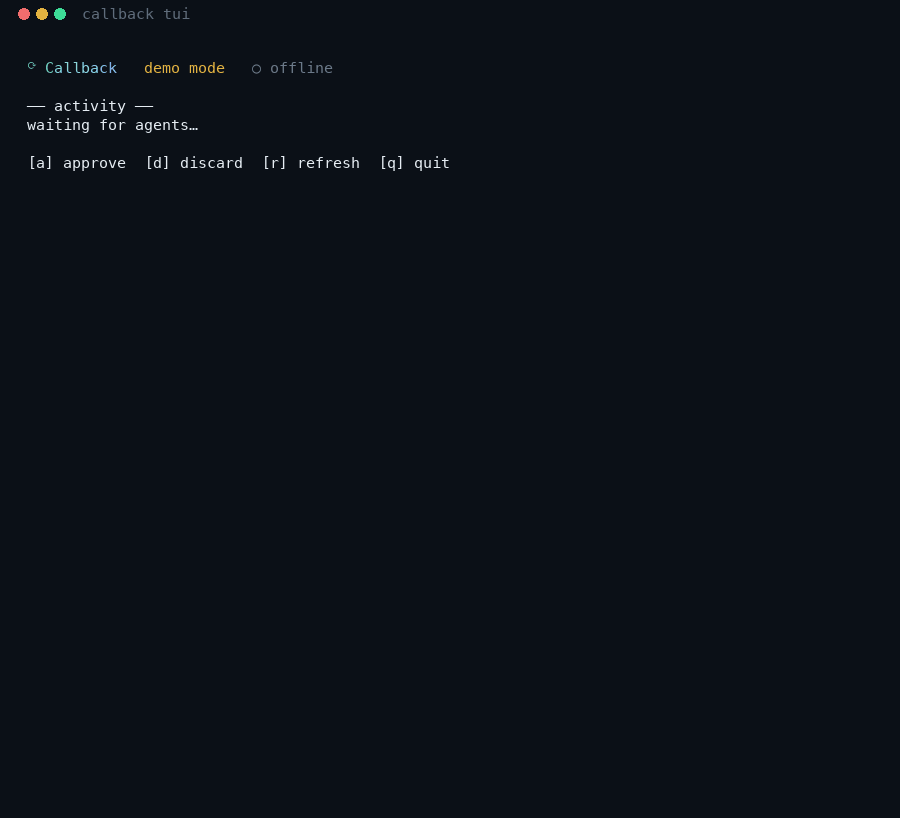

<div align="center">

# ⟳ Callback

**A local-first, open-source AI job-search & interview-prep agent.**
*Your data never leaves your machine. Built on Claude.*

[](LICENSE)
[](https://www.anthropic.com/claude)
[](#privacy--ethics)

*The open, local, honest alternative to spammy auto-appliers and sleazy interview copilots.*

</div>

<p align="center">
  
</p>

<p align="center"><sub>A real demo-mode run, recorded in the terminal UI: capture a job → agents analyze and draft → <b>you approve</b> the resume, then the cover letter → both saved under that job. The web dashboard shows the same run as a pipeline board.</sub></p>

> ⭐ **If you like the project, star the repo.** It's the one thing that helps other job seekers find an honest tool instead of a spam cannon.

---

## The problem

Job hunting in 2026 is a bot-vs-bot arms race. People fire off thousands of AI-generated applications; employers answer with AI screeners. The value of any single application is collapsing toward zero. The tools split into two broken halves:

- 🗑️ **Spammy auto-appliers** that optimize *volume* — now actively counterproductive, and usually against platform terms.
- 🕶️ **Real-time interview "copilots"** that feed you answers live — getting people **banned** (Amazon, Anthropic, Goldman and others prohibit them) and building zero real skill.

Every honest tool is a stateless silo — a resume builder here, a tracker there, mock interviews somewhere else — and **none of them remember *you***.

## What Callback does differently

Callback is one honest companion for the whole funnel, with a memory of you at its center:

- 🔎 **Captures roles and analyzes fit honestly** — surfaces gaps instead of hiding them; never keyword-stuffs.
- ✍️ **Tailors a resume *and* a cover letter for every job, from your *real* experience** — never fabricates a title, date, metric, or skill. Each job in your pipeline carries its own documents, its own prep pack, and its own mock-interview history (with the pipeline stage you practiced at), so nothing gets mixed up between roles.
- ✅ **Human-in-the-loop by design** — agents draft; *you* review and approve every document; Callback never auto-submits.
- 📄 **Your profile comes first** — upload your resume (PDF/DOCX/TXT); every agent reads it *before* doing anything, so drafts are grounded in your real experience, not scaffolds.
- 🗂️ **An experience bank you fill once** — import your CV, your LinkedIn data export, your public GitHub and pages you made, or just tell Callback what you did; it sorts each story into situation → what you did → result. Imports wait for your OK. Confirmed stories write your cover-letter evidence for you, keep numbers identical across every version, and count as verified in the honesty check. Answers you type into a draft's gaps can be saved there too, so you're never asked twice.
- 🛡️ **Treats job postings as untrusted input** — a posting guard strips hidden text and "ignore previous instructions" payloads before any agent reads a listing, and shows you what it removed.
- 📎 **Exports ATS-friendly PDF/DOCX and verifies them like a parser would** — reads the PDF's text layer back to check parseability, contact details, section headings, and keyword coverage, and **flags any number in your resume that your profile doesn't back up**. It refuses to export a draft with placeholders left in it.
- 🔌 **Runs three ways, one brain** — with an API key (built-in agents), **inside Claude Code on your subscription with no API key** (as a plugin), or key-free in demo mode. All share the same local memory.
- 🧠 **Learns what actually gets you callbacks** — after each outcome, it proposes lessons you approve, and feeds the active ones back into future drafts and prep. *This cross-application memory is what no other tool has.*
- 🎤 **Interview prep that makes you genuinely better** — personalized mock interviews, answer scoring, cross-session weakness tracking, and spaced repetition (grounded in deliberate-practice science). Prep *before* the interview — never cheating *during* it.
- 🔒 **Local-first & private** — no cloud, no account, no telemetry. Your resume, salary history, and the companies you're quietly applying to stay on your machine.
- 🖥️ **Two faces, one brain** — a graphical web **dashboard** and a themed **terminal UI**, both over the same local server.

## Quickstart

> Requires **Node 22.13+**. Zero native dependencies — it just installs.

```bash
npx callback-agent             # starts the local server and opens http://localhost:4317
```

That's it. (`callback` was already taken on npm, so the package is `callback-agent`; the command it installs is `callback`.) Prefer a checkout?

```bash
git clone https://github.com/nomadicmehul/Callback.git
cd Callback
npm install
node bin/callback.mjs          # first run builds the dashboard, then opens the browser
```

`callback --help` lists every command: `callback` (dashboard), `callback serve` (server only), `callback tui` (terminal UI), `callback mcp` (what the Claude Code plugin runs).

**Then, in the dashboard:** Settings → **upload your resume** (PDF, DOCX, or TXT). That's the ground truth every agent reads first. Now **Capture a job** — paste a posting or its URL — and watch the agents analyze fit, draft, and wait for your approval. When you have an interview coming, open **Interview**: mock interviews that score every answer on real signals, give you one concrete fix, remember your weak spots, and bring them back as spaced-repetition drills until they're strong.

### Pick how you want to run the brain

| You have… | Do this |
|---|---|
| **An Anthropic API key** | Add it in Settings. Callback's built-in agents (Claude Agent SDK) run live. [Get a key →](https://console.anthropic.com/) |
| **Claude Code (Pro/Max), no API key** | Use Callback **as a Claude Code plugin** — see below. Your subscription powers it; the dashboard still shows everything. |
| **Neither, just curious** | Nothing to set up. Callback runs a scripted **demo pipeline** — paste a job, watch agents work, approve a draft — without spending a token or sending anything anywhere. |

### No API key? Use it inside Claude Code

Callback is also a Claude Code plugin: the same skills + the same memory, driven by *your* Claude Code session. From the repo:

```bash
claude --plugin-dir .          # loads the plugin for this session
```

Then inside Claude Code:

```
/callback:setup        → add your resume (your profile — do this first)
/callback:story        → add real experience by talking it through (or import your CV / GitHub)
/callback:apply <url or pasted posting>   → analyze fit, tailor, you approve, saved
/callback:outcome <company> rejected|screen|interview|offer|ghosted [note]
                       → logs it and runs a retro that proposes lessons
/callback:mock-interview behavioral|technical|system_design
                       → scored mock interview; weak spots → memory; drills scheduled
```

Everything the plugin does lands in the same local database, so `callback` shows it in the dashboard. Installed from npm instead of a checkout? The package is a valid plugin folder too: `claude --plugin-dir node_modules/callback-agent`. (Once published to a marketplace it's a one-liner: `/plugin install callback --marketplace <owner>/<repo>`.)

**Terminal person?** `callback tui` launches the animated terminal UI — watch agents work, see what every job has, and approve drafts without leaving your shell. It starts the server for you if nothing is running.

**Developing?** `npm run dev` runs the server + Vite with hot reload (dashboard on `:5317`, server on `:4317`).

## How it works

```
  FACES                              BRAIN                                MEMORY
  web dashboard (React) ─┐
  terminal UI (Ink)     ─┼─▶ local server (127.0.0.1) ──┐
     ▲ live SSE ─────────┘   · built-in agents (Agent SDK, API key)     │
                             · posting guard · approvals · retro loop   ├─▶ ~/.callback/
  Claude Code (plugin) ────▶ stdio MCP server (your subscription) ─────┘   SQLite + your files
                             · same 10 tools, same skills                 never leaves your machine
```

Three ways in, one shared memory. The agents' *only* door to your data is a small set of MCP tools (`profile_get`, `application_create`, `memory_search`, `save_draft`, …) — never raw file or database access.

- **Model routing for cost:** Haiku for extraction, Sonnet for writing/coaching, Opus for orchestration — a full tailored application pass is roughly **$0.33**, a 20-turn mock interview roughly **$0.90**.
- **The memory of record is a SQLite ledger** your agents read and write through a small set of tools — never raw filesystem access.

## Skills (portable, drop-in)

Callback's methodology ships as open [Agent Skills](https://agentskills.io) under [`skills/`](skills/):

- **Workflows you invoke:** `setup` (profile first), `apply` (capture → analyze → tailor → approve), `outcome` (log + retro)
- **Methodology they follow:** `jd-analyzer`, `resume-tailor`, `cover-letter`, `mock-interview`, `retro`

They power Callback's own agents **and** load straight into Claude Code as the plugin's skills. Honesty rules are baked into each one.

## Privacy & ethics

Callback is built on a simple stance: **assist, don't deceive; keep the human in control.**

- ✅ **Assist, not automate** — it drafts and organizes; you review and click submit.
- ✅ **Honesty by construction** — it aligns to your *real* skills and never invents experience.
- ✅ **Sanctioned sources** — it works from job descriptions you provide; it does not run ToS-violating scraping or logged-in automation.
- ✅ **Prep, not cheat** — interview help builds durable skill and never operates during a live interview.
- ✅ **Your data, your machine** — see it, export it, delete it. No selling, no training on your data.

## Roadmap

- [x] Local server + web dashboard + SQLite memory + approval loop (demo & live drivers)
- [x] Portable core skills
- [x] Animated terminal UI (Ink)
- [x] Profile/CV ingestion (PDF, DOCX, TXT) — agents read it first
- [x] Claude Code plugin mode (no API key; stdio MCP server over the same memory)
- [x] URL job capture + posting guard (prompt-injection defense)
- [x] Outcome → automatic retro → proposed lessons
- [x] Interview-prep module — mock interviews scored on real signals, weakness memory, spaced-repetition drills, per-role prep packs
- [ ] Sanctioned job-source integrations (official APIs)
- [x] Resume PDF/DOCX export + ATS text-layer verification + in-app draft editing
- [x] Per-job materials — every job carries its own resume **and** cover letter, prep pack, and mock-interview record (with the pipeline stage you practiced at); nothing is shared across jobs
- [x] One-command `npx callback-agent` distribution — bundled server/TUI/MCP server, no TypeScript at runtime (publish pending)

## Contributing

Issues and PRs welcome. Please keep the honesty-first, local-first, human-in-the-loop principles intact.

## Like it? Star it ⭐

If Callback helped you land an interview, or you just like where it's going, **[star the repo](https://github.com/nomadicmehul/Callback)**. Stars are how a local-first, no-marketing-budget project gets found. Then tell one friend who's job hunting.

## License

[Apache License 2.0](LICENSE) — see [NOTICE](NOTICE).

---

<div align="center">
<sub>Built on <a href="https://www.anthropic.com/claude">Claude</a>. Not affiliated with or endorsed by Anthropic. No crypto, no token, no cloud — just a tool that helps you get a callback.</sub>
</div>
